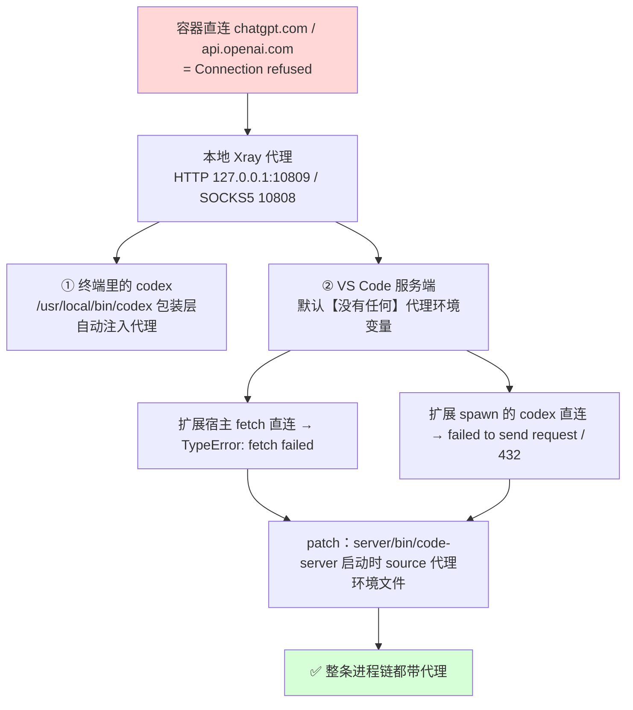

# autodl-codex-kit

> 在 **AutoDL**（或任意 root Linux 容器）上跑通 **Codex CLI 与 VS Code 的 Codex/ChatGPT 扩展**：
> 本地 Xray 代理 + 一键部署 + 踩坑实录

一个把「折腾几小时才跑通」的过程固化成**一条命令**的小套件。

---

## 这解决什么问题

三个连锁故障，单独看每个都像玄学：

1. **容器直连不了 OpenAI** —— `chatgpt.com` / `api.openai.com` 连接被拒，必须走代理；
2. **终端里的 codex 能用，VS Code 面板全废** —— `TypeError: fetch failed`、`failed to send request`、`status 432` 刷屏。
   原因是 Remote-SSH 启动的 VS Code 服务端**没有任何代理环境变量**，扩展宿主及其 spawn 的 codex 都在裸奔直连；
3. **改完配置还是不生效** —— 环境变量只在进程启动时读取，`Developer: Reload Window` 不够，**必须重启 VS Code 服务端**。

本项目把这三件事连同「沙箱在容器里失效」「TOML 配置被静默忽略」等一堆坑，全部固化进脚本。

---

## 快速开始

**前置条件**：root 权限 + 一份可用的代理订阅链接（脚本会自动把它转成 Xray 配置）。
默认按 AutoDL 布局（数据目录 `/root/autodl-tmp`），其它环境用 `XRAY_DATA_DIR` 覆盖。

```bash
git clone <本仓库地址> ~/autodl-tmp/autodl-codex-kit && cd ~/autodl-tmp/autodl-codex-kit

# ① 提供订阅链接（二选一）
export SUB_URL="https://你的订阅链接"
#   或写进文件（已被 .gitignore 忽略）： echo "https://你的订阅链接" > sub-url.txt

# ② 一键部署（幂等，可反复执行）
bash install.sh

# ③ 自检（--exec 会附带一次端到端实跑）
bash doctor.sh --exec

# ④ 开代理并验证
source /root/proxy-on.sh
codex exec "只回复两字：正常" --skip-git-repo-check

# ⑤ 让 VS Code 里的 Codex 面板生效（必须重启服务端）
bash /root/restart-vscode-server.sh
```

> 没有订阅？任何能提供本地 HTTP/SOCKS 代理的方式都行，把 `startup.sh` / `proxy-on.sh`
> 里的端口换成你的代理程序即可（默认 `HTTP 127.0.0.1:10809` / `SOCKS5 10808`）。

---

## 环境变量

| 变量 | 默认值 | 说明 |
|---|---|---|
| `SUB_URL` | 空 | 订阅链接；也可放 `sub-url.txt`（不入库）或 `/root/sub-url.txt` |
| `XRAY_DATA_DIR` | `/root/autodl-tmp` | 数据目录（AutoDL 数据盘） |
| `XRAY_DIR` | `$XRAY_DATA_DIR/xray-core` | xray 运行目录（配置 / 日志 / 订阅缓存） |
| `XRAY_BIN` | `/usr/local/bin/xray` | xray 可执行文件路径 |
| `XRAY_NODE_PY` | `/root/xray-node.py` | 节点工具位置（`xray-bench.py` 依赖它） |
| `KIT_NODE` | 空 | 首次部署自动选节点时的序号（默认优先「日本」） |

---

## 它做了什么（三层）

| 层 | 动作 | 关键文件 |
|---|---|---|
| **代理层** | 安装 xray、由订阅生成配置、幂等启动、开机自启、节点切换与测速 | `scripts/startup.sh`、`tools/xray-node.py`、`tools/xray-bench.py`、`conf/autodl-hook.sh` |
| **Codex 层** | 代理包装层（PATH 优先，避免「静默卡死」）、`config.toml` 模板（沙箱/审批/关闭 Apps） | `scripts/codex-wrapper.sh`、`conf/codex-config.toml.template` |
| **VS Code 层** | 给服务端启动脚本注入代理 env、Machine settings 配 `http.proxy` | `patches/patch-vscode-server.sh`、`scripts/vscode-proxy-env.sh` |

---

## 原理



关键结论：**代理注入必须发生在进程启动时**，所以补丁打在 VS Code 服务端的启动脚本上，
改完必须**重启服务端**（`Developer: Reload Window` 不够）。

---

## 目录结构

```
autodl-codex-kit/
├── install.sh                  ★ 一键部署（幂等，可反复执行）
├── doctor.sh                   ★ 分层自检体检（--exec 附带端到端实跑）
├── setup-github.sh               把本套件推送到你自己的仓库（自动接通代理）
├── scripts/                      待部署到系统各处的脚本（源文件，勿直接改 /root 下的副本）
│   ├── startup.sh              →  /root/startup.sh                幂等拉起 xray（开机/终端共用入口）
│   ├── proxy-on.sh             →  /root/proxy-on.sh               source 后当前 shell 带代理
│   ├── proxy-off.sh            →  /root/proxy-off.sh              source 后清除代理
│   ├── vscode-proxy-env.sh     →  /root/vscode-proxy-env.sh       VS Code 服务端代理环境注入
│   ├── restart-vscode-server.sh→  /root/restart-vscode-server.sh  重启服务端让 env 生效
│   └── codex-wrapper.sh        →  /usr/local/bin/codex            codex 包装层（自动注入代理）
├── tools/
│   ├── xray-node.py            →  /root/xray-node.py              节点列表/切换（读 SUB_URL）
│   └── xray-bench.py           →  /root/xray-bench.py             节点测速对比
├── patches/
│   └── patch-vscode-server.sh     给 VS Code 服务端启动脚本打代理补丁（升级后重跑）
├── conf/
│   ├── autodl-hook.sh          →  /etc/autodl.sh                  开机自启钩子（AutoDL 专用）
│   ├── bashrc-proxy-block.sh   →  追加到 /root/.bashrc            新终端代理逻辑
│   └── codex-config.toml.template →  /root/.codex/config.toml     Codex 配置模板
├── .gitignore                     排除大体积二进制与全部敏感/生成文件
├── bin/xray                       Xray 二进制（35MB）—— ⚠ 不入库，仅作离线兜底
└── assets/{geoip,geosite}.dat     geo 数据（30MB）—— ⚠ 不入库，仅作离线兜底
                                   （两者不入库时 install.sh 会自动下载补齐）
```

> 内部标识符说明：备份文件后缀为 `*.kit-bak`，`.bashrc` 标记为 `autodl-codex-kit`。

---

## 日常命令速查

| 目的 | 命令 |
|---|---|
| 开代理（当前终端） | `source /root/proxy-on.sh` |
| 关代理 | `source /root/proxy-off.sh` |
| 新终端自动开代理 | `touch ${XRAY_DIR:-/root/autodl-tmp/xray-core}/auto-proxy` |
| 取消自动开代理 | `rm ${XRAY_DIR:-/root/autodl-tmp/xray-core}/auto-proxy` |
| 列出所有节点 | `python3 /root/xray-node.py` |
| 切换节点 | `python3 /root/xray-node.py 3` |
| 更新订阅 | `python3 /root/xray-node.py -u` |
| 测速找最优节点 | `python3 /root/xray-bench.py 8 16 25 -n 3` |
| 体检 | `bash doctor.sh` |
| 体检 + 端到端实跑 | `bash doctor.sh --exec` |
| 重启 VS Code 服务端 | `bash /root/restart-vscode-server.sh` |
| 看代理日志 | `tail -30 ${XRAY_DIR:-/root/autodl-tmp/xray-core}/xray.log` |
| 查某进程有没有代理 | `tr '\0' '\n' < /proc/<PID>/environ \| grep -i proxy` |

---

## 坑位清单（血泪版）

| 坑 | 现象 | 正确做法 |
|---|---|---|
| 代理变量只对 source 过的终端有效 | 新终端里 codex **静默卡死**（无输出、不报错） | 由 `/usr/local/bin/codex` 包装层兜底；或 `touch auto-proxy` |
| VS Code 服务端无代理 env | 扩展报 `fetch failed` / `status 432` / 无限重试 | `patch-vscode-server.sh` + Machine settings `http.proxy` |
| 改了 env 但没重启服务端 | 补丁看起来生效了，报错照旧 | 必须 `restart-vscode-server.sh`（Reload Window 不够） |
| VS Code 升级 | 补丁失效，旧病复发 | 重跑 `patches/patch-vscode-server.sh`；`doctor.sh` 能检出 |
| 本版 VS Code 不支持 `server-env-setup` 钩子 | 按老教程配置无效 | 直接 patch `cli/servers/*/server/bin/code-server` 启动脚本 |
| 容器禁用 unshare / bubblewrap | `bwrap: No permissions to create new namespace`，codex 每条命令 exit 1 | `sandbox_mode = "danger-full-access"` |
| 顶层 TOML 键写在 `[table]` 之后 | 设置被静默忽略 | 顶层键一律写在所有 `[table]` 之前 |
| `[mcp_servers.codex_apps]` | 整份 config.toml 解析失败（`invalid transport`），所有设置连带失效 | 用 `features.apps = false` 关连接器 |
| 学术加速不转发 OpenAI 域名 | github/huggingface 通了，`chatgpt.com` 仍 000 | OpenAI 必须走自己的代理，学术加速救不了 |
| 香港节点 | 地区不支持，OpenAI 直接拒绝 | 选日本/美国等在支持地区内的节点 |
| `codex exec` 在非 git 目录 | 报 git 仓库检查失败 | 加 `--skip-git-repo-check` |
| `/root/.codex` 在系统盘 | 重置系统后登录凭据一起丢 | 需要就备份 `auth.json` |

---

## 故障速查表

| 症状 | 先查 | 十有八九的原因 |
|---|---|---|
| 终端 codex 无输出、卡死 | 该进程 `/proc/<pid>/environ` 有无 proxy | 当前终端没代理 |
| `fetch failed` / `failed to send request` | `doctor.sh` 第 ③ 节 | 服务端/扩展无代理，或没重启服务端 |
| `status 432` 刷屏 | 同上 | 同上（无代理时扩展的内部错误码） |
| `bwrap: No permissions` | `grep sandbox_mode ~/.codex/config.toml` | 沙箱没放开 |
| `invalid transport in mcp_servers.codex_apps` | 同上文件 | 删掉 `[mcp_servers.codex_apps]` |
| `Selected model is at capacity` | —— | 服务端临时容量问题，换模型或稍后重试 |
| 订阅接口 429 | —— | 限流；脚本会自动回退到本地缓存 `sub.txt` |
| 端口 10809 不通 | `tail $XRAY_DIR/xray.log` | 节点失效，换节点 |

---

## FAQ

**必须用机场订阅吗？**
不。任何能提供本地代理（HTTP 10809 / SOCKS5 10808）的方式都行。套件里「订阅 → Xray 配置」
那部分只是为了自动化；纯手工写好 `config.json` 也能用。

**换成 API Key 登录就不用代理了吗？**
不行。实测 `api.openai.com` 直连 `000`、走代理返回 `401`（仅缺凭据）。
网络可达性与凭据类型无关。另外注意：`gpt-5.6-luna` 这类是订阅态专有模型名，
API Key 模式下必须换成官方 API 真实存在的模型名。

**会泄露我的订阅链接吗？**
不会。订阅只出现在：`sub-url.txt`（`.gitignore` 忽略）、`/root/sub-url.txt`、
`$XRAY_DIR/config.json`、`$XRAY_DIR/sub.txt` —— **全部不入库**。
本仓库代码本身不含任何节点或订阅信息。

**能用在非 AutoDL 环境吗？**
需要 root，并会写入 `/root`、`/usr/local/bin`。开机自启那一步用的是 AutoDL 的
`/etc/autodl.sh` 钩子，其它系统请自行换成 cron/systemd（`install.sh` 会跳过不适用的步骤）。

**为什么不用 `~/.vscode-server/server-env-setup`？**
那是老版本 Remote-SSH 的钩子，本版（VS Code 1.123）的 CLI 已不读取它，实测无效。

---

## 迁移 Codex 登录凭据（换容器免重登）

ChatGPT 订阅登录走浏览器 OAuth，**容器内无法完成**。换容器时直接搬凭据即可：

```bash
# 旧容器：导出（auth.json 含 access/refresh token，注意保密）
cp /root/.codex/auth.json /root/autodl-tmp/codex-auth-backup.json

# 新容器：导入
mkdir -p /root/.codex && cp /root/autodl-tmp/codex-auth-backup.json /root/.codex/auth.json
chmod 600 /root/.codex/auth.json
bash doctor.sh        # 应显示 auth_mode=chatgpt
```

> ⚠ 前提是新容器**代理已通** —— access_token 只有 1 小时有效期，靠 refresh_token 续期，
> 没有网络就会表现为「登录状态正常但一用就失败」。

---

## 维护提醒

1. **VS Code 升级后**：重跑 `bash patches/patch-vscode-server.sh`（`doctor.sh` 会提示补丁缺失），再重启服务端。
2. **重置系统 / 换容器后**：重跑 `bash install.sh`（`/etc/autodl.sh`、`.bashrc` 段落都会丢）。
3. **换订阅 / 节点**：`python3 /root/xray-node.py -u` 更新，再切节点或跑 `xray-bench.py` 测速。
4. **改脚本**：请改 `scripts/`、`tools/`、`conf/` 下的源文件再重跑 `install.sh`；
   直接改 `/root/xxx.sh` 会在下次部署时被覆盖（改动前的原件备份为 `*.kit-bak`）。
5. **本项目自身备份**：`bash setup-github.sh <你的仓库地址>` 一条命令推到你自己的仓库。

---

## 免责声明

- 本项目仅供**学习研究与个人合法使用**网络代理工具、开发工具的自动化配置；
  请遵守你所在地区的法律法规以及相关服务的服务条款。
- 项目**不提供、不包含任何代理订阅或节点信息**，你需要自行准备合法可用的代理服务。
- 脚本按「现状（AS IS）」提供，不保证适用性与稳定性；所有被修改的系统文件均会先备份为 `*.kit-bak`。
- `sandbox_mode = "danger-full-access"` 会**关闭 Codex 的命令沙箱**（因为容器内沙箱本就不可用），
  请自行评估风险，不要在不受信任的仓库里放任其执行命令。

## 已验证环境

| 项 | 版本 |
|---|---|
| 系统 | AutoDL 容器（Ubuntu 22.04，root） |
| Node / codex | Node v22.23.2 / codex-cli 0.155.1 |
| VS Code | 1.123.0（Remote-SSH 远程模式） |
| Xray | 26.3.27 |
| 语言模型 | ChatGPT 订阅登录（auth_mode=chatgpt） |
